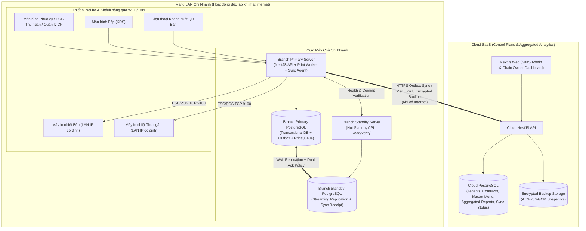
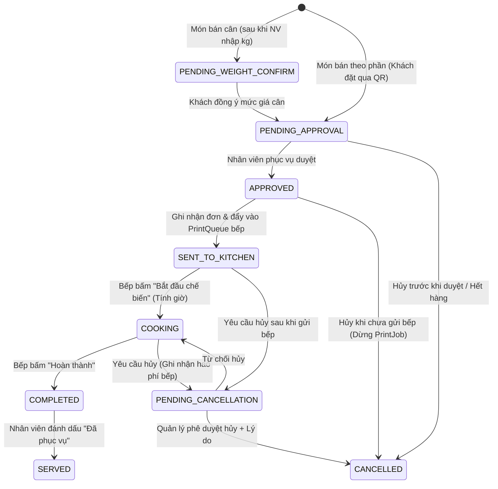

# KIẾN TRÚC HỆ THỐNG HYBRID & MONOREPO (SYSTEM ARCHITECTURE)

## 1. Tổng quan Kiến trúc Hybrid (Cloud SaaS + Branch Primary/Standby)

Hệ thống được thiết kế theo kiến trúc **Offline-First Hybrid SaaS**, trong đó máy chủ tại chi nhánh (Branch Node) là nguồn xử lý giao dịch trực tiếp (System of Record cho vận hành tại quán), còn Cloud SaaS đóng vai trò điều phối tập trung (Control Plane), tổng hợp báo cáo và lưu trữ sao lưu mã hóa.



---

## 2. Phân tách Bounded Contexts & Modules

Trong kiến trúc NestJS + Next.js Monorepo, hệ thống được chia thành 12 Bounded Contexts rõ ràng, không viết gộp logic:

1. **`IdentityAndAccess` (`auth`, `users`, `rbac`):** Xác thực Argon2id, quản lý phiên POS (tự khóa sau 15 phút không hoạt động nhưng bảo toàn state đang nhập), MFA (TOTP), quản lý tài khoản Kỹ thuật viên hỗ trợ từ xa (`SupportAccessGrant`) và quy trình phê duyệt thao tác nhạy cảm (`ApprovalRequest`).
2. **`TenantAndContract` (`tenants`, `contracts`, `branches`, `branding`):** Vòng đời hợp đồng, kiểm tra trạng thái hết hạn + 7 ngày gia hạn, phát hành `SignedLicenseLease` xuống chi nhánh, cấu hình nhận diện thương hiệu.
3. **`CatalogAndPricing` (`menu`, `pricing`, `menu-releases`):** Quản lý món ăn, nhóm món, lịch phát hành phiên bản theo múi giờ `Asia/Ho_Chi_Minh`, kế thừa (`INHERITED`) hoặc tự đặt giá (`OVERRIDE`) tại chi nhánh, phê duyệt tăng/giảm giá vượt khung, trạng thái hết hàng/ẩn món.
4. **`FloorAndSession` (`tables`, `sessions`, `qr-tokens`):** Quản lý sơ đồ bàn, mở/đóng phiên bàn, gộp bàn, chuyển bàn, phát hành và thu hồi QR token cố định/phiên động.
5. **`OrderingAndWeight` (`orders`, `order-rounds`, `weight-confirmations`):** Tiếp nhận lượt gọi món từ QR khách hoặc nhân viên, quy trình cân món và xác nhận giá với khách trước khi gửi bếp, duyệt đơn, thay thế món hết hàng khi khách đồng ý, hủy/điều chỉnh món theo từng nấc trạng thái.
6. **`KitchenAndPrinting` (`kds`, `printers`, `print-queue`):** Điều phối trạng thái chế biến trên màn hình bếp, tính thời gian chế biến từ lúc bấm `COOKING`, quản lý hàng đợi in bền vững (`PrintJob`) cho máy in bếp và máy in thu ngân, hỗ trợ `IN LẠI`.
7. **`BillingAndSplit` (`invoices`, `invoice-splits`, `discounts`):** Tạo hóa đơn từ phiên bàn, áp dụng 1 khoản giảm giá cấp hóa đơn (có kiểm tra hạn mức), tách hóa đơn chia đều theo số người/số bill với thuật toán phân bổ phần dư số nguyên VND.
8. **`PaymentsAndReceivables` (`payments`, `debts`, `refunds`, `adjustments`):** Ghi nhận thanh toán tiền mặt/chuyển khoản QR tĩnh, đóng bàn còn nợ, thu nợ vào ngày thực thu, hoàn tiền và điều chỉnh khiếu nại.
9. **`ReportingAndAnalytics` (`reports`, `business-calendar`, `exports`):** Tính toán ngày kinh doanh theo giờ mở ca của chi nhánh, báo cáo 8 chỉ số tiền tệ, lợi nhuận gộp ước tính từ snapshot giá vốn, xuất Excel/CSV/PDF và gói JSON bàn giao dữ liệu.
10. **`SyncAndIntegrity` (`idempotency`, `outbox`, `cloud-sync`, `reconciliation`):** Kiểm soát `Idempotency-Key`, hàng đợi sự kiện `OutboxEvent`, đồng bộ báo cáo tổng hợp lên Cloud, phát hiện bản ghi thiếu/xung đột và đối soát giao dịch có trạng thái chưa xác định (`UNCERTAIN`).
11. **`ClusterAndFailover` (`replication`, `backup`, `failover`):** Giám sát kết nối Primary–Standby, thực thi chính sách xác nhận lưu bền vững trên cả 2 máy chủ cho các giao dịch tài chính quan trọng, sao lưu cục bộ + sao lưu mã hóa lên Cloud, và trình hướng dẫn chuyển đổi dự phòng (Manual Guided Failover).
12. **`CustomerFeedback` (`ratings`):** Ghi nhận đánh giá 1–5 sao và nhận xét sau khi kết thúc phiên bàn (tối đa 1 đánh giá/phiên, không cần đăng nhập, chống spam).

---

## 3. Cấu trúc Monorepo

```text
c:\Users\Admin\Desktop\web app\
├── docs/                                 # Tài liệu kiến trúc & vận hành (Giai đoạn 1)
├── packages/
│   ├── hanyuflow/                        # Ứng dụng học tiếng Trung hiện có (giữ nguyên vẹn 100%)
│   ├── shared/                           # Domain types, state machines, VND math, schemas, RBAC permissions
│   ├── database/                         # Prisma schema, migrations, repository helpers, integrity checks
│   ├── backend/                          # NestJS Application (Cloud & Branch modes)
│   └── web/                              # Next.js Application (7 giao diện nghiệp vụ)
├── infra/
│   ├── docker/                           # Docker Compose (Primary, Standby, Cloud, PostgreSQL)
│   └── installer/                        # Script cài đặt tự động chi nhánh, kiểm tra phần cứng & mạng
└── package.json                          # Cấu hình npm workspaces
```

---

## 4. Thiết kế Các Luồng Giao dịch Quan trọng (Sequence & State Machines)

### 4.1. State Machine của Món trong Phiên bàn (`OrderItemStatus`)



> **Lưu ý thiết kế:** Khi món đã ở trạng thái `COMPLETED` hoặc `SERVED`, hệ thống **chặn chuyển sang `CANCELLED`**. Mọi khiếu nại hoặc miễn tiền ở giai đoạn này phải đi qua quy trình **Giảm giá (`Discount`)** hoặc **Điều chỉnh tài chính (`FinancialAdjustment`)** để giữ nguyên lịch sử chế biến và giá vốn đã xuất.

### 4.2. Luồng Xác nhận Giao dịch Quan trọng giữa Primary & Standby

Đối với 5 nhóm giao dịch trọng yếu: **(1) Duyệt & gửi đơn bếp, (2) Ghi nhận thanh toán, (3) Hủy hóa đơn/hủy món sau bếp, (4) Hoàn tiền, (5) Điều chỉnh tài chính**:

1. Client gửi request kèm header bắt buộc `Idempotency-Key` (UUID).
2. `PrimaryAPI` tính mã băm `payload_hash` (SHA-256).
   - Nếu `Idempotency-Key` đã tồn tại với cùng `payload_hash` và trạng thái `CONFIRMED`, trả về ngay kết quả đã lưu.
   - Nếu cùng `Idempotency-Key` nhưng khác `payload_hash`, trả lỗi `409 Conflict (IDEMPOTENCY_PAYLOAD_MISMATCH)` và ghi log cảnh báo.
3. `PrimaryAPI` mở database transaction trên `PrimaryDB`, ghi bản ghi giao dịch với trạng thái commit nội bộ và kiểm tra xác nhận đồng bộ sang `StandbyDB` (thông qua PostgreSQL synchronous replication `synchronous_commit = remote_write / on` hoặc cơ chế `StandbySyncReceipt` có chữ ký xác nhận từ `StandbyAPI`).
4. **Chính sách khi Standby mất kết nối:**
   - Hệ thống **không âm thầm trả về `200 OK (CONFIRMED)`** như thể dữ liệu đã an toàn trên 2 máy.
   - Giao dịch được đánh dấu rõ trạng thái `PERSISTED_PRIMARY_ONLY_PENDING_STANDBY_ACK` (hoặc tạm dừng nhận giao dịch tài chính mới theo cấu hình an toàn của chi nhánh), cảnh báo đỏ lập tức trên màn hình Thu ngân/Quản lý chi nhánh và Dashboard kỹ thuật.
   - Khi người dùng bấm lại, nhờ `Idempotency-Key`, hệ thống kiểm tra trạng thái giao dịch đang chờ mà không bao giờ tạo giao dịch thứ hai.
