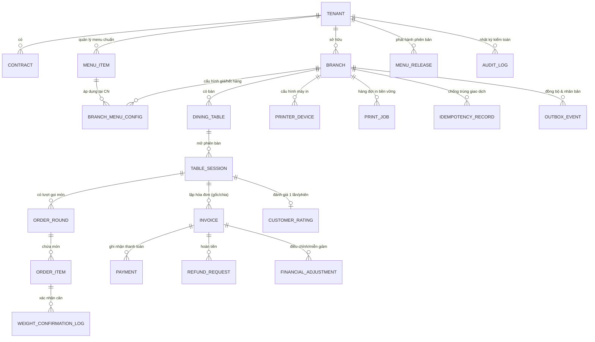

# MÔ HÌNH DỮ LIỆU & THIẾT KẾ CƠ SỞ DỮ LIỆU (DATA MODEL & ERD)

## 1. Nguyên tắc Thiết kế Dữ liệu Bắt buộc

1. **Định danh Duy nhất Toàn Hệ thống:** Mọi bảng đều có khóa chính nội bộ `id` kiểu `UUID` (ưu tiên UUIDv7 có thứ tự thời gian). Mã hiển thị nghiệp vụ (như `display_code = BG01-20261016-0001` của hóa đơn) chỉ là cột chỉ mục phục vụ tra cứu, **không dùng làm khóa chính duy nhất**.
2. **Tiền tệ Số nguyên VND Tuyệt đối:** Tất cả các cột lưu tiền tệ (`price_vnd`, `estimated_cost_vnd`, `subtotal_vnd`, `discount_amount_vnd`, `total_amount_vnd`, `paid_amount_vnd`, `debt_amount_vnd`, `refund_amount_vnd`) đều dùng kiểu **`BIGINT` (hoặc `INTEGER`)** biểu diễn đơn vị đồng (`VND`). Tuyệt đối không dùng `FLOAT` hay `DOUBLE`.
3. **Trọng lượng & Số lượng:** Cột trọng lượng món bán theo cân (`weight_kg`) dùng `DECIMAL(10, 3)` (độ chính xác tới gram, ví dụ `0.920` kg). Số lượng phần dùng `INTEGER` ($\ge 1$).
4. **Không xóa cứng (No Hard Delete) Dữ liệu Giao dịch & Danh mục Đã Phát sinh Giao dịch:**
   - Món ăn (`MenuItem`), Bàn (`DiningTable`), Phiên bàn (`TableSession`), Lượt gọi món (`OrderRound`), Chi tiết món (`OrderItem`), Hóa đơn (`Invoice`), Thanh toán (`Payment`), Hoàn tiền (`Refund`), Điều chỉnh (`FinancialAdjustment`) và Nhật ký (`AuditLog`) đều bất biến hoặc chuyển trạng thái; database trigger/application guard ngăn lệnh `DELETE` trên các bảng đã phát sinh giao dịch.
5. **Tách biệt Timestamp Sự kiện và Ngày Kinh doanh (`business_date`):**
   - Mọi sự kiện lưu `occurred_at` (`TIMESTAMPTZ`, chuẩn UTC, hiển thị theo `Asia/Ho_Chi_Minh`) và `business_date` (`DATE`, tính theo `business_day_start_hour` của từng chi nhánh, ví dụ `04:00` sáng).

---

## 2. Sơ đồ Quan hệ Thực thể (ERD Tổng quát)

---

## 3. Chi tiết Các Bảng Cốt lõi

### 3.1. Phân hệ Tenant, Hợp đồng & Chi nhánh

- **`tenants`**:
  - `id` (UUID, PK), `code` (VARCHAR, unique), `brand_name`, `status` (`ACTIVE`, `SUSPENDED`, `TERMINATED`), `logo_url`, `primary_color`, `cover_image_url`, `banner_url`, `custom_domain`, `config_version` (INT), `created_at`, `updated_at`.
- **`contracts`**:
  - `id` (UUID, PK), `tenant_id` (UUID, FK), `billing_cycle` (`MONTHLY`, `YEARLY`), `start_date` (DATE), `end_date` (DATE), `grace_period_days` (INT, default `7`), `warning_days_before` (INT[], default `[30,14,7,3,1]`), `terms_json`, `status` (`ACTIVE`, `GRACE_PERIOD`, `EXPIRED_RESTRICTED`, `TERMINATED`), `signed_license_token` (TEXT).
- **`branches`**:
  - `id` (UUID, PK), `tenant_id` (UUID, FK), `code` (VARCHAR, ví dụ `BG01`), `name`, `address`, `phone`, `timezone` (default `'Asia/Ho_Chi_Minh'`), `business_day_start_hour` (INT, 0..23, default `4`), `status` (`ACTIVE`, `CLOSING`, `CLOSED`), `active_menu_version` (INT), `primary_server_id`, `standby_server_id`, `last_cloud_sync_at` (TIMESTAMPTZ), `last_backup_at` (TIMESTAMPTZ).

### 3.2. Phân hệ Người dùng, RBAC & Hỗ trợ Từ xa

- **`users`**:
  - `id` (UUID, PK), `tenant_id` (UUID, nullable cho SaaS staff), `branch_id` (UUID, nullable cho Chain Owner/SaaS staff), `username`, `email`, `password_hash` (Argon2id), `role` (`SAAS_ADMIN`, `TECH_SUPPORT`, `CHAIN_OWNER`, `BRANCH_MANAGER`, `CASHIER`, `WAITER`, `KITCHEN_STAFF`), `mfa_enabled` (BOOL), `mfa_secret_enc` (TEXT), `failed_login_attempts` (INT), `locked_until` (TIMESTAMPTZ), `status` (`ACTIVE`, `DISABLED`), `pos_pin_hash` (nullable, chỉ dùng để mở khóa nhanh màn hình POS sau 15 phút nghỉ trong cùng phiên).
- **`user_sessions`**:
  - `id` (UUID, PK), `user_id` (UUID, FK), `token_hash`, `is_pos_locked` (BOOL), `last_activity_at` (TIMESTAMPTZ), `expires_at` (TIMESTAMPTZ), `revoked_at` (TIMESTAMPTZ).
- **`support_access_grants`** (Hỗ trợ từ xa có phê duyệt):
  - `id` (UUID, PK), `tenant_id`, `branch_id`, `technician_user_id`, `requested_by_user_id`, `approved_by_user_id`, `scope` (`DIAGNOSTICS_READ`, `PRINTER_CONFIG`, `SYNC_RECOVERY`, `FAILOVER_ASSIST`), `reason`, `starts_at`, `expires_at`, `revoked_at`.
- **`approval_requests`** (Phê duyệt 9 thao tác nhạy cảm):
  - `id` (UUID, PK), `tenant_id`, `branch_id`, `action_type` (ENUM 9 thao tác nhạy cảm), `resource_type`, `resource_id`, `requested_by_user_id`, `approved_by_user_id`, `reason` (TEXT, NOT NULL), `payload_json`, `status` (`PENDING`, `APPROVED`, `REJECTED`, `EXPIRED`), `created_at`, `decided_at`.

### 3.3. Phân hệ Menu Chuỗi, Giá Chi nhánh & Lịch phát hành

- **`menu_categories`**:
  - `id` (UUID, PK), `tenant_id`, `code`, `name`, `sort_order`, `is_active`.
- **`menu_items`**:
  - `id` (UUID, PK), `tenant_id`, `category_id`, `code` (unique per tenant), `name`, `description`, `image_url`, `selling_unit` (`PORTION`, `KG`, `PLATE`, `COMBO`), `is_weight_based` (BOOL), `standard_price_vnd` (BIGINT, nullable nếu bán cân), `standard_price_per_kg_vnd` (BIGINT, nullable), `standard_estimated_cost_vnd` (BIGINT, nullable — **NULL nghĩa là chưa có dữ liệu giá vốn, không gán 0**), `standard_estimated_cost_per_kg_vnd` (BIGINT, nullable), `standard_prep_minutes` (INT), `allowed_prep_notes` (TEXT[]), `default_status` (`AVAILABLE`, `OUT_OF_STOCK`, `HIDDEN`), `version` (INT), `copied_from_item_id` (UUID, nullable), `has_transactions` (BOOL, default `false`).
- **`branch_menu_configs`**:
  - `id` (UUID, PK), `tenant_id`, `branch_id`, `menu_item_id`,
  - `price_mode` (`INHERITED` | `OVERRIDE`),
  - `override_price_vnd` (BIGINT, nullable),
  - `override_price_per_kg_vnd` (BIGINT, nullable),
  - `cost_mode` (`INHERITED` | `OVERRIDE`),
  - `override_estimated_cost_vnd` (BIGINT, nullable),
  - `override_estimated_cost_per_kg_vnd` (BIGINT, nullable),
  - `availability_status` (`AVAILABLE`, `OUT_OF_STOCK`, `HIDDEN`),
  - `prep_minutes_override` (INT, nullable),
  - `synced_menu_version` (INT).
- **`menu_releases`**:
  - `id` (UUID, PK), `tenant_id`, `version_number` (INT), `scheduled_for` (TIMESTAMPTZ, `Asia/Ho_Chi_Minh`), `published_at` (TIMESTAMPTZ), `snapshot_json` (JSONB), `created_by_user_id`, `restored_from_version` (INT, nullable).

### 3.4. Phân hệ Bàn, Phiên bàn, QR, Order & Bếp

- **`dining_tables`**:
  - `id` (UUID, PK), `tenant_id`, `branch_id`, `code` (ví dụ `B01`), `name`, `area_name`, `capacity`, `status` (`AVAILABLE`, `OCCUPIED`, `PENDING_PAYMENT`, `CLEANING`), `qr_static_key` (VARCHAR, có thể thu hồi & phát hành lại), `qr_version` (INT), `merged_into_session_id` (UUID, nullable).
- **`table_sessions`**:
  - `id` (UUID, PK), `tenant_id`, `branch_id`, `primary_table_id` (UUID, FK), `merged_table_ids` (UUID[]), `session_token` (VARCHAR, mất hiệu lực ngay khi đóng), `business_date` (DATE), `status` (`OPEN`, `LOCKED_FOR_PAYMENT`, `CLOSED`, `CLOSED_WITH_DEBT`), `opened_by_user_id`, `closed_by_user_id`, `opened_at`, `closed_at`, `close_debt_approval_id` (UUID, nullable), `close_debt_reason` (TEXT, nullable).
- **`order_rounds`** (Mỗi lượt gọi món lưu riêng, phục vụ chỉ in món mới):
  - `id` (UUID, PK), `tenant_id`, `branch_id`, `table_session_id`, `round_number` (INT: 1, 2, 3...), `source` (`CUSTOMER_QR`, `STAFF_POS`), `status` (`PENDING_APPROVAL`, `APPROVED`, `REJECTED`), `approved_by_user_id`, `created_at`, `approved_at`.
- **`order_items`**:
  - `id` (UUID, PK), `tenant_id`, `branch_id`, `table_session_id`, `order_round_id`, `menu_item_id`,
  - **Snapshots bất biến tại thời điểm đặt:** `item_name_snapshot`, `selling_unit_snapshot`, `is_weight_based_snapshot` (BOOL), `unit_price_vnd_snapshot` (BIGINT), `price_per_kg_vnd_snapshot` (BIGINT, nullable), `estimated_unit_cost_vnd_snapshot` (BIGINT, nullable), `estimated_cost_per_kg_vnd_snapshot` (BIGINT, nullable),
  - `quantity` (INT), `weight_kg` (DECIMAL(10,3), nullable), `line_total_vnd` (BIGINT), `estimated_line_cost_vnd` (BIGINT, nullable),
  - `prep_notes` (TEXT),
  - `status` (`PENDING_WEIGHT_CONFIRM`, `PENDING_APPROVAL`, `APPROVED`, `SENT_TO_KITCHEN`, `COOKING`, `COMPLETED`, `SERVED`, `PENDING_CANCELLATION`, `CANCELLED`),
  - `replaced_from_order_item_id` (UUID, nullable — khi đổi món hết hàng), `replacement_reason` (TEXT, nullable), `customer_agreed_replacement_at` (TIMESTAMPTZ, nullable),
  - `kitchen_sent_at`, `cooking_started_at` (Mốc tính thời gian chuẩn bị), `completed_at`, `served_at`, `cancelled_at`, `cancellation_reason`, `cancellation_approval_id`, `incurred_kitchen_waste` (BOOL, default `false`).

### 3.5. Phân hệ Máy in, Hóa đơn, Thanh toán, Công nợ & Hoàn tiền

- **`print_jobs`**:
  - `id` (UUID, PK), `tenant_id`, `branch_id`, `printer_role` (`KITCHEN`, `CASHIER`), `job_type` (`KITCHEN_ROUND_TICKET`, `INVOICE_RECEIPT`), `reference_id` (UUID — `order_round_id` hoặc `invoice_id`), `is_reprint` (BOOL, nếu `true` bắt buộc in nhãn `"IN LẠI"`), `payload_json` (JSONB), `status` (`QUEUED`, `SENDING`, `DISPATCHED_UNVERIFIED`, `CONFIRMED_BY_STAFF`, `FAILED`, `CANCELLED_BEFORE_SEND`), `retry_count` (INT), `last_error` (TEXT), `created_at`, `updated_at`.
- **`invoices`**:
  - `id` (UUID, PK), `tenant_id`, `branch_id`, `table_session_id`, `parent_invoice_id` (UUID, nullable — khi tách bill), `split_index` (INT, nullable), `split_total_parts` (INT, nullable),
  - `display_code` (VARCHAR, ví dụ `BG01-20261016-0001`), `business_date` (DATE),
  - `subtotal_vnd` (BIGINT),
  - `discount_type` (`NONE`, `AMOUNT`, `PERCENT`), `discount_value` (INT), `discount_amount_vnd` (BIGINT), `discount_reason` (TEXT), `discount_by_user_id` (UUID), `discount_approval_id` (UUID, nullable),
  - `adjustment_amount_vnd` (BIGINT, default `0`),
  - `total_amount_vnd` (BIGINT), `paid_amount_vnd` (BIGINT), `refunded_amount_vnd` (BIGINT), `debt_amount_vnd` (BIGINT),
  - `status` (`DRAFT`, `UNPAID`, `PARTIALLY_PAID`, `PAID`, `VOIDED`, `REFUNDED_PARTIAL`, `REFUNDED_FULL`),
  - `void_reason` (TEXT, nullable), `void_approval_id` (UUID, nullable).
- **`payments`**:
  - `id` (UUID, PK), `tenant_id`, `branch_id`, `invoice_id`, `method` (`CASH`, `BANK_TRANSFER_STATIC_QR`), `amount_vnd` (BIGINT), `reference_code` (VARCHAR, nullable), `recorded_by_user_id` (UUID), `paid_at` (TIMESTAMPTZ), `collected_business_date` (DATE — dùng để ghi nhận tiền thực thu cho cả trường hợp trả nợ sau ngày đóng bàn), `is_debt_collection` (BOOL), `status` (`CONFIRMED`, `PENDING_STANDBY_ACK`).
- **`refund_requests`**:
  - `id` (UUID, PK), `tenant_id`, `branch_id`, `invoice_id`, `amount_vnd` (BIGINT), `method` (`CASH`, `BANK_TRANSFER_EXTERNAL`), `reason` (TEXT, NOT NULL), `external_reference` (VARCHAR), `requested_by_user_id`, `approved_by_user_id`, `status` (`REQUESTED`, `APPROVED`, `EXECUTED`, `REJECTED`), `executed_at`, `refund_business_date` (DATE).

### 3.6. Phân hệ Idempotency, Outbox & Audit Log

- **`idempotency_records`**:
  - `idempotency_key` (VARCHAR, PK cùng `tenant_id`, `branch_id`), `endpoint` (VARCHAR), `payload_hash` (VARCHAR(64)), `status` (`PROCESSING`, `PERSISTED_LOCAL`, `CONFIRMED_DUAL_NODE`, `UNCERTAIN_NEEDS_RECONCILIATION`, `FAILED`), `response_status_code` (INT), `response_body_json` (JSONB), `created_at`, `expires_at`.
- **`outbox_events`**:
  - `id` (UUID, PK), `tenant_id`, `branch_id`, `sequence_number` (BIGSERIAL), `event_type` (VARCHAR), `aggregate_type` (VARCHAR), `aggregate_id` (UUID), `payload_json` (JSONB), `standby_acked_at` (TIMESTAMPTZ, nullable), `cloud_synced_at` (TIMESTAMPTZ, nullable), `sync_status` (`PENDING`, `SYNCED`, `FAILED_RETRYING`, `CONFLICT_DETECTED`), `retry_count` (INT), `last_error` (TEXT).
- **`audit_logs`**:
  - `id` (UUID, PK), `tenant_id`, `branch_id`, `actor_user_id`, `actor_role`, `support_grant_id` (UUID, nullable), `action`, `resource_type`, `resource_id`, `reason`, `before_json`, `after_json`, `ip_address`, `occurred_at`.
