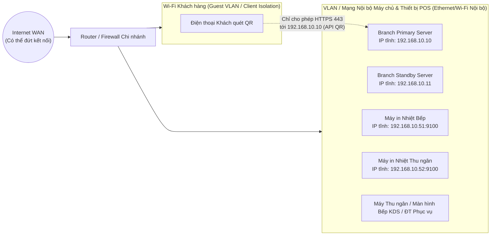

# TRIỂN KHAI HẠ TẦNG, MẠNG CHI NHÁNH & VẬN HÀNH (DEPLOYMENT & OPERATIONS)

## 1. Kiến trúc Triển khai Docker Compose

Hệ thống cung cấp cấu hình Docker Compose chuẩn hóa cho 2 môi trường:
1. **`infra/docker/docker-compose.cloud.yml`**: Triển khai cụm Cloud SaaS (Cloud API, Cloud Web Dashboard, Cloud PostgreSQL, Encrypted Backup Receiver).
2. **`infra/docker/docker-compose.branch.yml`**: Triển khai tại từng chi nhánh cho **Máy chủ chính (`Primary`)** và **Máy chủ dự phòng (`Standby`)**.

### Cấu hình Phần cứng Khởi điểm tại Chi nhánh
- **CPU:** Tối thiểu 4 nhân (4 cores) trở lên.
- **RAM:** Tối thiểu 8 GB (Khuyến nghị 16 GB).
- **Lưu trữ:** Ổ cứng SSD từ 256 GB trở lên (không dùng HDD cơ học cho PostgreSQL).
- **Hệ điều hành:** Ubuntu Server LTS 64-bit (22.04 / 24.04 LTS) hoặc môi trường Linux Server tương đương.
- **Kết nối mạng:** Cáp mạng Ethernet LAN Gigabit ổn định cho cả máy chủ chính, máy chủ dự phòng và 2 máy in nhiệt.
- **Lưu ý quan trọng:** Không mặc định sử dụng máy tính thu ngân cá nhân đang dùng văn phòng/giải trí hàng ngày làm máy chủ chính nếu chưa vượt qua bài kiểm tra phần cứng, ổ cứng, nguồn điện và chính sách cô lập dịch vụ của trình cài đặt.

---

## 2. Thiết kế Mạng Nội bộ Chi nhánh (Branch LAN & Wi-Fi)

### Quy tắc Cấu hình Mạng & Firewall tại Chi nhánh
1. **IP Cố định / DHCP Reservation:**
   - Gán địa chỉ IP tĩnh theo MAC Address trên Router cho: Máy chủ chính (`192.168.10.10`), Máy chủ dự phòng (`192.168.10.11`), Máy in bếp (`192.168.10.51`), và Máy in thu ngân (`192.168.10.52`).
2. **Truy cập QR trong LAN khi mất Internet:**
   - Điện thoại khách kết nối Wi-Fi của quán sẽ truy cập trực tiếp địa chỉ nội bộ hoặc tên miền nội bộ được phân giải qua Local DNS của Router về IP của Máy chủ chính (`192.168.10.10`).
3. **Cô lập Mạng (Network Segmentation):**
   - Nếu thiết bị mạng hỗ trợ VLAN/Guest Firewall: Wi-Fi Khách chỉ được phép gọi cổng HTTPS (`443`/`8443`) của dịch vụ Web/QR trên Máy chủ chính; **chặn hoàn toàn** Wi-Fi Khách kết nối tới cổng máy in (`9100`), cổng PostgreSQL (`5432`), SSH (`22`) và máy chủ dự phòng.
   - Tuyệt đối không NAT/Port-forward cổng PostgreSQL (`5432`), SSH (`22`) hoặc RDP (`3389`) ra ngoài Internet. Kênh hỗ trợ kỹ thuật từ xa đi qua VPN (WireGuard/Tailscale) hoặc kênh điều khiển có phê duyệt.

---

## 3. Trình Cài đặt Tự động Chi nhánh (`infra/installer/branch-installer`)

Trình cài đặt tự động thực hiện tuần tự 12 bước kiểm tra và thiết lập an toàn (không bao giờ tự ý xóa hay cài lại hệ điều hành của máy khách):

1. Kiểm tra thông số CPU ($\ge 4$ cores), RAM ($\ge 8\text{ GB}$), và kiến trúc 64-bit.
2. Kiểm tra dung lượng trống ổ đĩa SSD ($\ge 50\text{ GB}$ khả dụng cho khởi tạo).
3. Kiểm tra và xác nhận cấu hình IP tĩnh của máy chủ.
4. Sinh bộ khóa mật mã (`JWT_SECRET`, `BACKUP_ENCRYPTION_KEY`, `DB_PASSWORD`) ngẫu nhiên an toàn (CSPRNG) với quyền truy cập file `0600`.
5. Khởi chạy container cơ sở dữ liệu PostgreSQL và kiểm tra khả năng ghi bền vững (`fsync`).
6. Chạy database migrations một cách an toàn.
7. Khởi tạo dữ liệu cấu hình chi nhánh và tài khoản Quản trị/Quản lý đầu tiên theo quy trình bảo mật (không tạo mật khẩu mặc định cố định).
8. Kiểm tra kết nối TCP tới IP của Máy in Bếp và Máy in Thu ngân.
9. Chạy kiểm tra sức khỏe toàn diện (`Health Check`).
10. Chạy thử nghiệm tạo bản sao lưu cục bộ (`Backup Smoke Test`) và kiểm tra checksum.
11. Kiểm tra kết nối đồng bộ tới Máy chủ dự phòng và Cloud SaaS.
12. Xuất **Báo cáo Cài đặt Chi nhánh (`installation-report.json` & `.md`)** có dấu thời gian và chữ ký kiểm tra.

---

## 4. Quy trình Cập nhật Phần mềm An toàn (Staged Rollout)

1. `SAAS_ADMIN` phát hành phiên bản mới lên kho lưu trữ kèm ghi chú migration.
2. `TECH_SUPPORT` chọn **từng chi nhánh một** (không bao giờ cập nhật đồng loạt toàn chuỗi cùng lúc) vào khung giờ bảo trì (ngoài giờ cao điểm).
3. Script cập nhật tự động kiểm tra điều kiện tiên quyết (`Pre-Update Gate`):
   - Máy chủ chính và dự phòng đang khỏe mạnh.
   - Đã chạy thành công một bản Full Backup ngay trước khi cập nhật.
   - Hàng đợi `OutboxEvent` không bị kẹt lỗi nghiêm trọng.
   - Không có phiên bàn nào đang ở trạng thái giao dịch dở dang (hoặc phải được Quản lý chi nhánh xác nhận).
4. Thực thi cập nhật ứng dụng và chạy migration tương thích tiến (`Forward-compatible migration`).
5. Chạy `Health Check` + `Business Smoke Test` tự động.
6. Nếu phát hiện lỗi nghiêm trọng, dừng ngay việc triển khai sang các chi nhánh tiếp theo. Nếu đã phát sinh giao dịch mới sau khi cập nhật, **không bao giờ rollback database mù quáng làm mất giao dịch mới**, mà áp dụng bản vá tiến hoặc quy trình phục hồi có đối soát.
