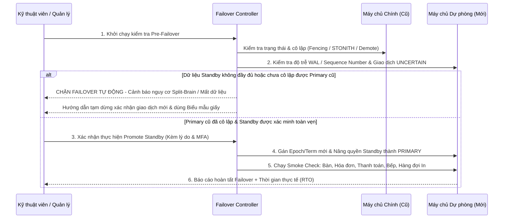

# ĐỒNG BỘ, TÍNH TOÀN VẸN, SAO LƯU & CHUYỂN ĐỔI DỰ PHÒNG (SYNC, INTEGRITY & FAILOVER)

## 1. Phân loại Trạng thái Giao dịch & Idempotency Tuyệt đối

Để bảo đảm không mất giao dịch và không tạo giao dịch trùng lặp khi mạng chập chờn hoặc người dùng nhấn nhiều lần, mọi giao dịch quan trọng (tạo/duyệt đơn, thanh toán, hủy, hoàn tiền, điều chỉnh) đều đi qua máy trạng thái toàn vẹn 5 cấp độ:

1. **`PROCESSING`**: Yêu cầu vừa được tiếp nhận, khóa theo `(tenant_id, branch_id, idempotency_key)`.
2. **`PERSISTED_LOCAL`**: Giao dịch đã được ghi bền vững vào ổ đĩa (WAL flushed) trên cơ sở dữ liệu của Máy chủ chính (`PrimaryDB`), nhưng chưa nhận được xác nhận từ Máy chủ dự phòng (`StandbyDB`).
3. **`CONFIRMED_DUAL_NODE`**: Cả Máy chủ chính (`Primary`) và Máy chủ dự phòng (`Standby`) đều đã xác nhận lưu bền vững bản ghi giao dịch. Chỉ khi đạt trạng thái này, hệ thống mới trả kết quả **Đã xác nhận hoàn toàn (`CONFIRMED`)** theo chính sách bảo vệ kép.
4. **`SYNCED_TO_CLOUD`**: Sự kiện tổng hợp/báo cáo tương ứng trong bảng `outbox_events` đã được đồng bộ lên Cloud SaaS và nhận phản hồi xác nhận.
5. **`UNCERTAIN_NEEDS_RECONCILIATION`**: Giao dịch bị gián đoạn giữa chừng (ví dụ: mất điện đột ngột hoặc mất kết nối giữa Primary và Standby ngay thời điểm commit). Hệ thống đưa vào danh sách cần đối soát, hiển thị cảnh báo rõ ràng cho Quản lý/Thu ngân và chặn việc tạo giao dịch trùng.

### Quy tắc Xử lý `Idempotency-Key`
- Mỗi request thay đổi dữ liệu tài chính/đơn hàng bắt buộc gửi kèm `Idempotency-Key` và hệ thống băm nội dung body bằng `SHA-256` (`payload_hash`).
- **Trùng `Idempotency-Key` + Trùng `payload_hash`:** Trả lại chính xác kết quả của giao dịch gốc (không thực thi lại logic cộng tiền, không tạo thanh toán thứ hai, không tạo phiếu in tự động thứ hai).
- **Trùng `Idempotency-Key` + Khác `payload_hash`:** Từ chối ngay với mã lỗi `409 IDEMPOTENCY_KEY_REUSED_WITH_DIFFERENT_PAYLOAD` và ghi vào `audit_logs` + cảnh báo kỹ thuật.

---

## 2. Chính sách Xác nhận Kép giữa Máy chủ Chính (Primary) và Dự phòng (Standby)

- Tại mỗi chi nhánh có 2 máy chủ vật lý trong cùng mạng LAN Ethernet: **Primary Server** và **Standby Server**.
- Đối với các thao tác tài chính quan trọng (Duyệt đơn gửi bếp, Thanh toán, Hủy hóa đơn, Hoàn tiền, Điều chỉnh):
  - Sau khi ghi vào `PrimaryDB`, dịch vụ `ReplicationCoordinator` yêu cầu xác nhận lưu bền vững từ `Standby` (qua WAL LSN position hoặc synchronous replication receipt).
  - **Nếu `Standby` phản hồi thành công trong ngưỡng timeout (ví dụ 1500ms):** Giao dịch chuyển sang `CONFIRMED_DUAL_NODE` và trả thành công cho người dùng.
  - **Nếu `Standby` không phản hồi hoặc lỗi:**
    - Hệ thống **tuyệt đối không âm thầm báo thành công như bình thường**.
    - Trả về trạng thái cảnh báo `DEGRADED_STANDBY_UNCONFIRMED` (hoặc tạm dừng xác nhận giao dịch tài chính mới theo chế độ `STRICT_DUAL_ACK` đã cấu hình), đồng thời bật biểu ngữ cảnh báo đỏ trên màn hình POS và Dashboard: *"Máy chủ dự phòng chưa xác nhận dữ liệu — Vui lòng kiểm tra kết nối LAN giữa 2 máy chủ hoặc chuyển sang quy trình an toàn"*.
    - Không nhầm lẫn trạng thái **mất Internet (Cloud Offline)** với **mất kết nối giữa 2 máy chủ nội bộ (Standby Unreachable)**: Khi chỉ mất Internet mà mạng LAN giữa Primary và Standby vẫn tốt, chi nhánh vẫn đạt `CONFIRMED_DUAL_NODE` và hoạt động 100% bình thường.

---

## 3. Đồng bộ Cloud (Outbox Pattern) & Nguyên tắc Không Ghi đè Dữ liệu Cục bộ

1. **Chiều từ Chi nhánh lên Cloud (Branch $\rightarrow$ Cloud):**
   - Mọi thay đổi trạng thái đơn hàng, hóa đơn, thanh toán, công nợ, hoàn tiền, đánh giá của khách và chỉ số sức khỏe máy chủ được ghi trong cùng database transaction vào bảng `outbox_events` với số thứ tự tăng dần đơn điệu `sequence_number`.
   - Tiến trình nền `CloudSyncWorker` đọc các bản ghi `PENDING` theo lô, gửi lên Cloud kèm `sequence_number` và `idempotency_key`.
   - Cloud kiểm tra khoảng trống `sequence_number` (`Gap Detection`): nếu chi nhánh gửi bản ghi số `105` khi Cloud mới nhận tới `102`, Cloud phát hiện thiếu bản ghi `103, 104` và yêu cầu chi nhánh truyền bù.
   - Cloud tổng hợp báo cáo mà **không bao giờ cộng doanh thu hai lần** khi một sự kiện được gửi lại.
2. **Chiều từ Cloud xuống Chi nhánh (Cloud $\rightarrow$ Branch):**
   - Chỉ đồng bộ: cấu hình Tenant/Hợp đồng (`SignedLicenseLease`), cấu hình thương hiệu, phiên bản Menu chuẩn mới (`MenuRelease`), và quyết định phê duyệt từ Chủ chuỗi.
   - **Quy tắc bất biến:** Dữ liệu từ Cloud **không bao giờ được phép ghi đè ngược lên dữ liệu giao dịch cục bộ** (bàn, phiên bàn, hóa đơn, thanh toán) tại chi nhánh, và việc cập nhật phiên bản Menu mới không bao giờ sửa lại giá bán hay giá vốn của các hóa đơn/đơn hàng đã tạo trước đó.

---

## 4. Sao lưu (Backup) & Kiểm thử Phục hồi (Restore Verification)

1. **Sao lưu Liên tục & Định kỳ:**
   - **Liên tục:** Ghi nhận thay đổi qua WAL archiving và nhân bản trực tiếp từ Primary sang Standby.
   - **Hằng ngày (Daily Full Backup):** Tạo bản chụp đầy đủ cơ sở dữ liệu chi nhánh vào cuối ngày kinh doanh, lưu tại ổ đĩa cục bộ (`Local Backup`) và mã hóa `AES-256-GCM` đẩy lên `Cloud Backup Vault` khi có Internet.
2. **Kiểm tra Toàn vẹn & Diễn tập Phục hồi:**
   - Mỗi bản backup kèm theo manifest JSON chứa: `backup_id`, `branch_id`, `created_at`, `max_outbox_sequence`, `invoice_count`, `total_revenue_vnd`, và `sha256_checksum`.
   - Công cụ `verify-backup-restore` thực hiện giải mã, khôi phục vào một database/schema cách ly (`isolated_restore_test`), chạy truy vấn kiểm tra tổng số hóa đơn, tổng tiền thanh toán và tính toàn vẹn khóa ngoại, sau đó mới đánh dấu bản backup là `VERIFIED_RESTORABLE`. Không bao giờ coi việc "tạo file backup thành công" là bằng chứng duy nhất rằng có thể khôi phục.

---

## 5. Quy trình Chuyển đổi Máy chủ Dự phòng (Guided Manual Failover) & Chống Split-Brain

Mục tiêu thời gian phục hồi (RTO) ban đầu là **$\le 30$ phút** theo quy trình có hướng dẫn từng bước, có kiểm tra khóa an toàn:

### Quy tắc Khi Máy chủ Cũ Hoạt động Trở lại (No Automatic Failback)
- Máy chủ vừa được nâng quyền (Standby cũ) **tiếp tục giữ vai trò Primary**.
- Máy chủ cũ khi bật lại thấy `cluster_epoch` của mình thấp hơn sẽ **tự động khóa quyền ghi (Read-Only / Quarantined)** để ngăn chặn tuyệt đối hiện tượng 2 máy chủ cùng nhận ghi (`Split-Brain`).
- Kỹ thuật viên phải chạy quy trình đối soát các giao dịch `UNCERTAIN`, đồng bộ lại dữ liệu từ Primary hiện hành sang máy cũ, và xác minh hoàn tất trước khi đưa máy cũ vào vai trò `Standby`.
- Hàng đợi in khi khởi động lại hoặc sau failover **không bao giờ tự động in lại các phiếu đã hoàn tất**.

---

## 6. Phục hồi Sau Mất điện & Biểu mẫu Giấy Dự phòng

- MVP không giả định chi nhánh có bộ lưu điện (UPS).
- Khi có điện trở lại, script khởi động tuân thủ thứ tự:
  `PostgreSQL Primary` $\rightarrow$ `Integrity & Crash Recovery Check` $\rightarrow$ `Replication Verification` $\rightarrow$ `Print Queue Reconciliation` $\rightarrow$ `NestJS API & Next.js Web`.
- Mọi giao dịch đang dở dang lúc sập nguồn sẽ nằm ở trạng thái `UNCERTAIN_NEEDS_RECONCILIATION`; hệ thống yêu cầu Thu ngân/Quản lý kiểm chứng thực tế trước khi xác nhận, không tự động đánh dấu đã thu tiền.
- Trong thời gian mất điện hoàn toàn, nhân viên sử dụng **Biểu mẫu Order & Thanh toán bằng giấy chuẩn hóa** (được cung cấp kèm trong bộ tài liệu vận hành) và nhập đối soát lại khi hệ thống hoạt động trở lại.
- **Tuyên bố trung thực về giới hạn chịu lỗi:** Hệ thống bảo vệ dữ liệu trước sự cố hỏng 1 máy chủ hoặc mất mạng Internet, nhưng **không tuyên bố bất tử 100%** trong thảm họa vật lý làm hỏng đồng thời cả Máy chủ chính, Máy chủ dự phòng tại quán khi chưa kịp đồng bộ bản sao lưu mới nhất lên Cloud.
